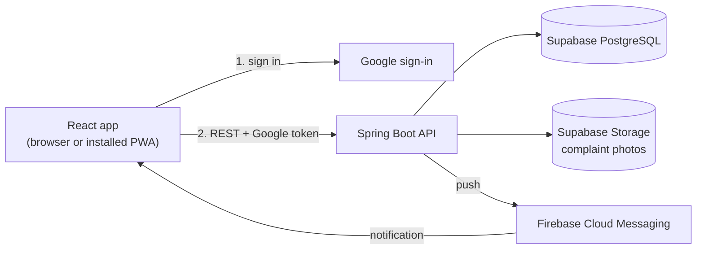
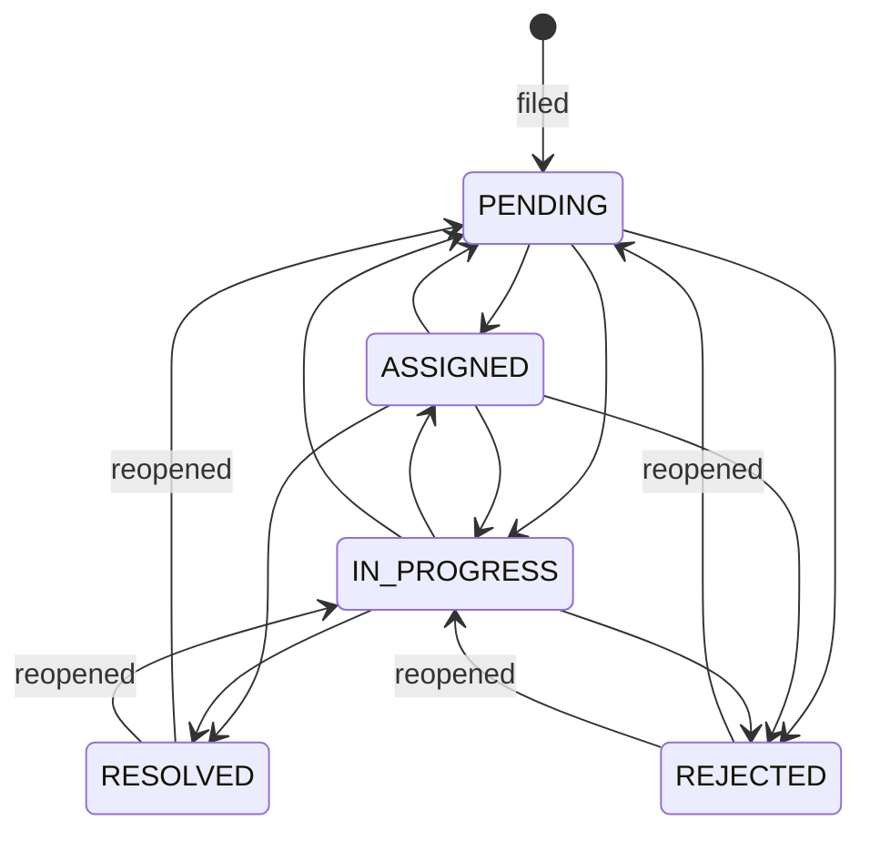

# Architecture

## Overview

There is one backend and one database. The backend holds no sessions: the browser sends its Google ID token with every request.

### Backend layout

Code is in `backend/src/main/java/com/example/demo/hostel/`.

| Package | Purpose |
|---|---|
| `controller` | HTTP endpoints |
| `service` | Business rules |
| `repository` | Database queries |
| `model` | Database entities |
| `dto` | What the API sends and receives |
| `config` | Security, rate limiting, Firebase |
| `specification` | Admin complaint filters |
| `validation` | Hostel room and floor rules |

## Roles and sign-in

| Role | Who | How the role is decided |
|---|---|---|
| `STUDENT` | Verified `@smail.iitm.ac.in` accounts | Created automatically on first sign-in |
| `STAFF` | Hostel staff, on any Google account | An admin adds their email in Staff management |
| `ADMIN` | A small fixed group | Listed in the `ADMIN_EMAILS` setting |

Admins are configured rather than stored, because they rarely change and someone has to be able to add the first staff member.

The login page has two tabs, both handled by `POST /api/auth/login`:

| | Student Login | Staff Login |
|---|---|---|
| New smail student | Account created | 403 |
| Existing student | Signed in | 403 |
| Other personal email | 401 | 403 |
| Staff added by an admin | 401, "use Staff Login" | Signed in |
| Listed admin | Refused, "use Staff Login" | Signed in (created on first sign-in) |

An smail address only counts if Google also confirms the domain through the token's `hd` claim.

The tabs are only the entrance. **Every** later request is checked again by `CustomJwtAuthenticationConverter`, which calls `AuthService.processGoogleLogin`, so a removed staff member is blocked on their next action.

`SecurityConfig` applies these URL rules:

| Path | Allowed |
|---|---|
| `/health`, `POST /api/auth/login` | Anyone |
| `/api/admin/staff/**` | Admins |
| `/api/admin/**`, `/api/work-orders/**` | Admins and staff |
| Everything else | Any signed-in user |

## Complaint workflow

`ComplaintTransitionService` is the only place a status changes. It refuses any other move with a 409, writes the history row in the same transaction, and notifies the reporter after the transaction commits.

- `ASSIGNED → RESOLVED` is allowed for small jobs nobody marked as started. `PENDING → RESOLVED` is not.
- The frontend's `STATUS_TRANSITIONS` in `AdminHome.jsx` must match these rules.

## Work orders

A work order means someone has taken responsibility for a complaint. A complaint has at most one active work order, enforced by a partial unique index.

| Work order status | Complaint becomes |
|---|---|
| Created (`OPEN`) | `ASSIGNED`, if it was `PENDING` |
| `IN_PROGRESS` | `IN_PROGRESS` |
| `DONE` | `RESOLVED`, with the notes in its history |
| `CANCELLED` | `PENDING` and unassigned |

The link works both ways. If someone changes a complaint's status directly, `WorkOrderService.syncWithComplaintStatus` updates the work order:

| Complaint set to | Active work order becomes |
|---|---|
| `RESOLVED` | `DONE` |
| `REJECTED` | `CANCELLED` |
| `PENDING` | `CANCELLED`, and the complaint is unassigned |
| `IN_PROGRESS` | `IN_PROGRESS`; a closed complaint resumes its last work order |
| `ASSIGNED` | `OPEN` |

Staff can only assign themselves, and only if nobody else holds the complaint. Removing a staff member moves their active work to someone else, or returns it to Pending.

Deadlines are hostel wall-clock times in IST, so `WorkOrderService` compares them with the time in IST. Other timestamps are set by the server and sent as UTC without an offset; the frontend reads them with `utils/serverDate.js`.

## Duplicate detection

While someone types a title, `GET /api/complaints/potential-duplicates` searches open complaints using PostgreSQL's `pg_trgm` similarity, with a threshold of 0.3, and returns up to three. It searches the same floor for community issues and the same room for room issues. Students can upvote a match instead of filing a new complaint.

## Limits

| Limit | Value | Where |
|---|---|---|
| Open complaints (Pending, Assigned, In Progress) | 5 for students, 50 for staff and admins | `ComplaintService` |
| Filing rate | 5 per minute per user | `ComplaintRateLimiter` |
| Photo size | 5 MB; JPEG, PNG or WebP | `SupabaseStorageService` |

The rate limit is held in memory, which suits a single server instance.

## Deleting and archiving

| Job | When | What it does |
|---|---|---|
| Delete | Owner, while Pending | Soft delete: sets `deleted_at`, which hides the complaint everywhere |
| `ComplaintArchivalService` | Daily, 2:00 AM IST | Archives complaints resolved or rejected over 30 days ago |
| `ComplaintPurgeService` | Daily, 3:00 AM IST | Permanently removes complaints deleted over 15 days ago, and their photos |

Archived complaints leave the admin dashboard, but their owners can still see them. Reopening a complaint brings it back.

## Concurrency

`Complaint` has a `@Version` field. If two people change a complaint at the same moment, the second gets a 409 instead of overwriting the first.

## Notifications

Notifications use Firebase Cloud Messaging. The frontend asks for permission, gets a device token, and saves it with `PUT /api/users/{id}/fcm-token`.

| Event | Who is told |
|---|---|
| Complaint status changes | The person who filed it |
| A complaint is assigned to someone else | The new assignee |

Assigning yourself and editing a priority or deadline send nothing.

What the person sees depends on the page:

| HostelFix tab | Result |
|---|---|
| Visible and focused | In-app pop-up |
| Visible but not focused | In-app pop-up and system notification |
| Hidden or closed | System notification, from `firebase-messaging-sw.js` |

Things to know:
- Nothing is stored, so there is no notification history. The timeline shows every status change.
- Each user has one saved device. Registering a new one replaces the old one.
- Logging out removes the device, so signed-out users get nothing.
- Notifications are sent only after the change is committed, and a failed send never fails the request.

## Security notes

- Google tokens are verified against Google's keys and this app's client ID.
- API responses for students leave out other people's account details; history shows staff as "Hostel office".
- Secrets stay out of Git: `.env` files and the Firebase service account file are ignored.
