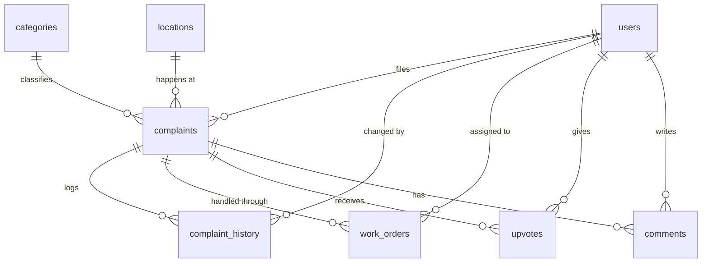

# Database

HostelFix uses PostgreSQL on Supabase. The local app and the live site share the same database, whose address is in `application.properties`.

## Tables



| Table | Purpose | Key columns |
|---|---|---|
| `users` | Everyone who can sign in | `email`, `role`, `full_name`, `phone_number`, `roll_number`, `room_number`, `fcm_token` |
| `complaints` | Reported issues | `student_id` (whoever filed it, including staff), `status`, `assigned_to`, `image_url`, `is_archived`, `deleted_at`, `version` |
| `categories` | Kinds of issue | `name`, `default_sla_hours` |
| `locations` | Rooms and community areas | `floor`, `room_number`, `wing`, `is_community_area` |
| `complaint_history` | Every status change | `old_status`, `new_status`, `reason`, `actor_id`, `changed_at` |
| `work_orders` | Who is responsible for a complaint | `assignee_id`, `priority`, `status`, `deadline`, `completion_notes` |
| `upvotes` | "This affects me too" | One row per complaint and user |
| `comments` | Notes on a complaint | Not used by the API yet |

## Things to know

- **Id types:** `complaints.id` is a `BIGINT`, and `users.id` is a `VARCHAR` holding a UUID.
- **Soft delete:** rows with `deleted_at` set are hidden by the `Complaint` entity, then removed after 15 days.
- **Status values:** these are stored as text and defined by enums in `model/`.
- **One active work order:** the unique index `uk_work_orders_one_active_per_complaint` covers `OPEN` and `IN_PROGRESS` rows only, so finished work orders stay as a record.
- **`assigned_to`:** this holds the assignee's email, for the admin table. The work order is the real link.
- **Older assignments:** complaints assigned before work orders existed have `assigned_to` set but no work order. They count as zero in Staff management until they're assigned again.

## Migrations

Spring doesn't run these files. Run them by hand in the Supabase SQL editor, in this order. All are safe to re-run. They're in `backend/src/main/resources/`.

| File | What it does |
|---|---|
| `schema.sql` | Normalises complaints into categories and locations, and creates the history table |
| `schema_oct18.sql` | Work orders, comments and upvotes |
| `schema_oct22.sql` | `users.fcm_token` |
| `schema_oct23.sql` | Profile fields, available time and key with security |
| `schema_oct24.sql` | `complaints.is_archived` |
| `schema_oct25.sql` | The `pg_trgm` extension and search indexes |
| `schema_nov01.sql` | `complaints.deleted_at` |
| `schema_nov02.sql` | `complaints.version` |
| `schema_nov03.sql` | Work order changes and the one-active-work-order index |
| `schema_nov06.sql` | Allows the `STAFF` role in `users` |

`spring.jpa.hibernate.ddl-auto=update` adds new tables and columns on startup, but it doesn't create the indexes above or change existing check constraints. So the migrations are still needed.

### Checking what's been applied

```sql
SELECT
  (SELECT count(*) FROM pg_extension WHERE extname = 'pg_trgm') AS oct25,
  (SELECT count(*) FROM information_schema.columns
    WHERE table_name = 'complaints' AND column_name = 'deleted_at') AS nov01,
  (SELECT count(*) FROM information_schema.columns
    WHERE table_name = 'complaints' AND column_name = 'version') AS nov02,
  (SELECT count(*) FROM pg_indexes
    WHERE indexname = 'uk_work_orders_one_active_per_complaint') AS nov03,
  (SELECT pg_get_constraintdef(oid) LIKE '%STAFF%' FROM pg_constraint
    WHERE conname = 'users_role_check') AS nov06;
```

The result should be `1, 1, 1, 1, true`.

### Adding a migration

- Name it `schema_<month><day>.sql`, and make it safe to re-run.
- If you add a value to an enum stored in an existing table, check whether the column has a check constraint. Hibernate won't update it, and the H2 tests won't catch it, so add a Postgres test.
